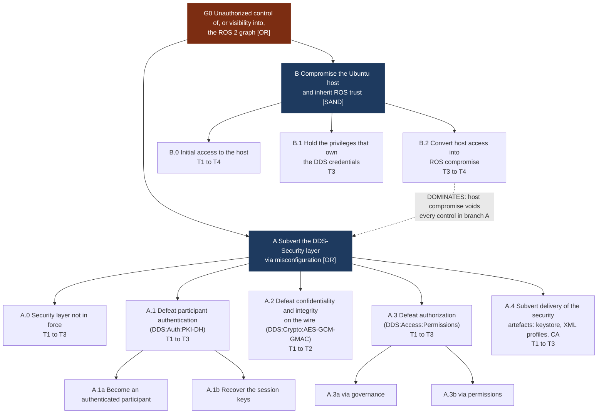

## 1. Top-level tree

> The dotted edge is the key structural point: **branch B dominates branch A.** A perfectly configured DDS-Security stack on a host the attacker owns provides no assurance, because the private keys, the governance document and the environment variables all live on that host.

---

## Sources

- [ROS 2 design, DDS-Security integration](https://design.ros2.org/articles/ros2_dds_security.html)
- [ROS 2 Jazzy, About security](https://docs.ros.org/en/jazzy/Concepts/Intermediate/About-Security.html)
- [OMG DDS-Security v1.1](https://www.omg.org/spec/DDS-SECURITY/1.1/PDF)
- Jhawar, R., Kordy, B., Mauw, S., Radomirovic, S. and Trujillo-Rasua, R. ["Attack Trees with Sequential Conjunction"](https://doi.org/10.1007/978-3-319-18467-8_23), IFIP SEC 2015
