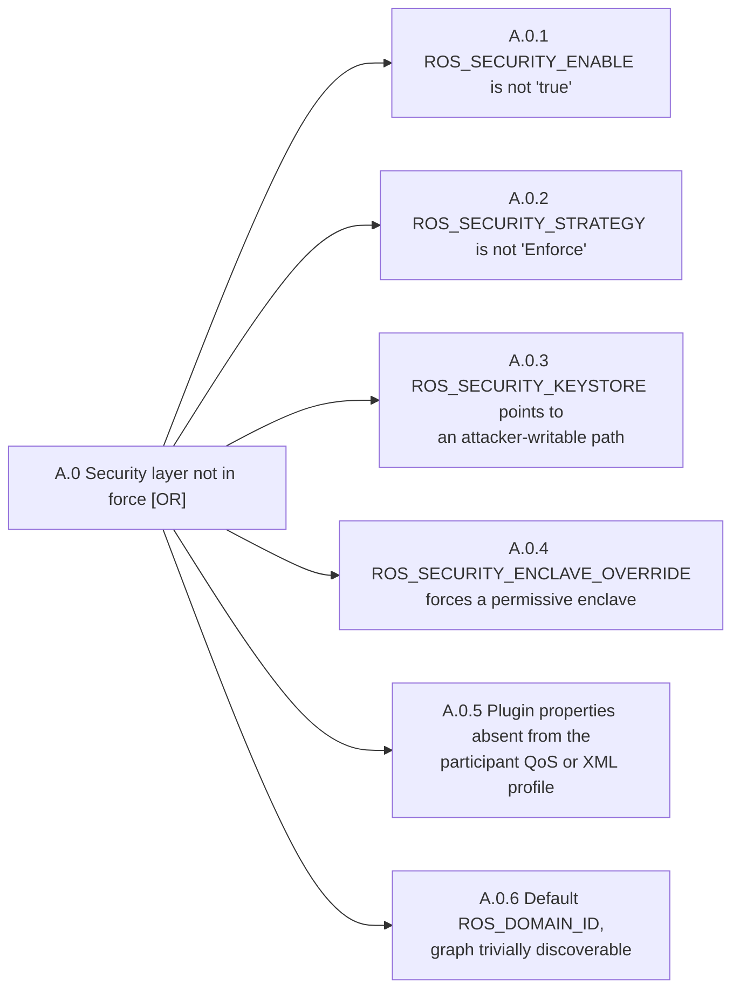

## A.0 Security layer not in force (T1 to T3)



Commands below use `$KEYSTORE`, `$ENVFILE`, `$RUN` and the rest; [the README](../../README.md) sets them.

### A.0.1 Security enabled

`Cons E1 E2 E3 E4` · `T T1` · `P P3` · `X X3`

**Parameter.** `ROS_SECURITY_ENABLE`

**Misconfigured value.** Is not `true`

**Path to effect.** SROS2 is silently off. An attacker on the same L2/L3 segment joins the domain as a plain DDS participant, with full read and write on every topic.

```sh
grep ROS_SECURITY_ENABLE $ENVFILE
```

Anything but the exact lowercase `true` is the finding, and an absent variable is the default, which is off. Check every file that sets it, not just the one you were handed: B.2.2 is about there being more than one.

```sh
env -u ROS_SECURITY_ENABLE -u ROS_SECURITY_STRATEGY \
    -u ROS_SECURITY_KEYSTORE -u ROS_SECURITY_ENCLAVE_OVERRIDE \
    ROS_DOMAIN_ID=$DOMAIN ros2 topic list -t
```

The T1 check: an unauthenticated participant enumerating the graph is the finding. The `env -u` is not decoration. With those variables exported you are a *credentialed* participant and the same output means the opposite.

**Example**, the lab in its `all-open` posture:

```
ROS_SECURITY_ENABLE=false
```

**Zenoh.** On rmw_zenoh, `ROS_SECURITY_ENABLE=true` only makes rcl refuse to start a node whose enclave is missing. It encrypts and authenticates nothing. Transport security comes only from the configs that `ZENOH_ROUTER_CONFIG_URI` and `ZENOH_SESSION_CONFIG_URI` name.

```sh
grep -E '^(ROS_SECURITY_ENABLE|ZENOH_ROUTER_CONFIG_URI|ZENOH_SESSION_CONFIG_URI)=' $ENVFILE
```

`ROS_SECURITY_ENABLE=true` with either URI unset or empty is the finding. Every process then runs on the rmw_zenoh defaults, plaintext TCP with no access control, and a client with no credentials reads and writes every topic.

### A.0.2 Strategy enforcing

`Cons E1 E2 E3 E4` · `T T1` · `P P3` · `X X3`

**Parameter.** `ROS_SECURITY_STRATEGY`

**Misconfigured value.** Missing or not equal to `Enforce`, so **Permissive** by default

**Path to effect.** An attacker, or a fault, removes or renames one enclave file and the node starts **without security** instead of failing. Silent downgrade.

```sh
grep ROS_SECURITY_STRATEGY $ENVFILE
```

Absent means `Permissive`, which is the finding. Confirm by removing one enclave file on a lab copy and watching the node start anyway.

**Example**, the lab in its `all-open` posture:

```
ROS_SECURITY_STRATEGY=Permissive
```

**Zenoh.** As for A.0.1: `Enforce` makes a node with a missing enclave refuse to start, and does nothing for the transport. Check the two `ZENOH_*_CONFIG_URI` variables as in A.0.1.

### A.0.3 Keystore not attacker-writable

`Cons E1 E2 E3 E4` · `T T3` · `P P2` · `X X2`

**Parameter.** `ROS_SECURITY_KEYSTORE`

**Misconfigured value.** Path under `/tmp`, `/home/<user>`, a mounted share, or a world-writable directory

**Path to effect.** Attacker substitutes a keystore whose CA they control, so their own nodes become legitimate.

```sh
stat -Lc '%a %U %G' $KEYSTORE
namei -l $KEYSTORE
```

Group or world writable is the finding. `namei` is the part a single `stat` misses: a `0750` keystore under a `0777` parent directory is writable by way of rename. A path under `/tmp`, `/var/tmp`, `/home` or `/dev/shm` is the finding regardless of mode.

**Example**, the lab in its `all-open` posture, excerpt:

```
777 root rostarget
drwxrwxrwx root rostarget target-keystore
```

**Zenoh.** Unchanged. Zenoh's mTLS reads its certificates and keys from the same enclave directories. The Zenoh configs themselves are A.4.1.

### A.0.4 No enclave override

`Cons E1 E2 E3` · `T T3` · `P P2` · `X X3`

**Parameter.** `ROS_SECURITY_ENCLAVE_OVERRIDE`

**Misconfigured value.** A broad or debug enclave, for example a `/` enclave with `topics: "*"`, which takes precedence over the keystore and over `--enclave`

**Path to effect.** Every node on the robot runs with the widest grant in the keystore, so per-node least privilege collapses.

```sh
grep ROS_SECURITY_ENCLAVE_OVERRIDE $ENVFILE
```

A non-empty value is the finding; the lab's `target.env` always carries the line, and empty means unset. It outranks both the keystore layout and `--enclave`, so its value is the enclave every node on the robot actually runs with.

**Example**, the lab in its `all-open` posture:

```
ROS_SECURITY_ENCLAVE_OVERRIDE=/robot
```

**Zenoh.** `ZENOH_CONFIG_OVERRIDE` overrides any key of either config and outranks the file: `access_control/enabled=false` turns authorization off, and `listen/endpoints` or the `transport/link` keys put the transport back on plaintext.

```sh
grep '^ZENOH_CONFIG_OVERRIDE=' $ENVFILE
$RUN sh -c "for p in \$(pgrep -u $ROSUSER); do tr '\\0' '\\n' < /proc/\$p/environ | grep '^ZENOH_CONFIG_OVERRIDE=' | sed \"s|^|\$p: |\"; done"
```

A value that touches `access_control`, `listen`, `connect` or `transport/link` is the finding wherever it is set, unless it only points `connect/endpoints` at a `tls/` or `quic/` endpoint: the lab's peer sets that to dial the robot's router. Any other value on the robot needs a documented reason.

### A.0.5 Plugin properties present

`Cons E1 E2 E3 E4` · `T T1` · `P P1` · `X X3`

**Parameter.** `dds.sec.auth.plugin`, `dds.sec.crypto.plugin`, `dds.sec.access.plugin`

**Misconfigured value.** Missing from the participant `PropertyPolicyQoS` or the Fast DDS XML profile

**Cyclone DDS.** Cyclone has no plugin-name property. A plugin is instantiated when its element is present under `//CycloneDDS/Domain/Security`: `<Authentication>`, `<Cryptographic>` and `<AccessControl>`, in the file `CYCLONEDDS_URI` names. Each one is the builtin plugin unless its `<Library path=...>` names another shared object.

**Path to effect.** The corresponding plugin is not instantiated. No error, no security.

```sh
xmllint --xpath '//*[local-name()="property"]' $XMLPROFILE
```

All three of `dds.sec.auth.plugin`, `dds.sec.crypto.plugin` and `dds.sec.access.plugin` must appear. Absence from the XML is not conclusive on its own. With `ROS_SECURITY_ENABLE=true` and an enclave found, `rmw_fastrtps_cpp` sets the three plugin properties in code from the enclave, as Cyclone does below: the lab with `TARGET_OMIT_PLUGINS=true` alone has none in its profile and still refuses an unauthenticated subscriber. Absence decides the leaf together with A.0.1, or for an application that configures Fast DDS without rmw.

On Cyclone DDS:

```sh
xmllint --xpath '//*[local-name()="Security"]/*' $XMLPROFILE
```

`<Authentication>`, `<Cryptographic>` and `<AccessControl>` must all appear. The same caveat holds: with `ROS_SECURITY_ENABLE=true`, `rmw_cyclonedds_cpp` builds these settings from the enclave in code, so a config file without a `<Security>` section is ordinary and decides nothing on its own.

**Example**, the lab in its `all-open` posture:

```
XPath set is empty
(exit 10)
```

**Zenoh.** No plugins. The three questions become: is the ACL on, is mTLS on, and is every endpoint encrypted.

```sh
zq $ZSESSION access_control.enabled
zq $ZSESSION transport.link.tls.enable_mtls
zq $ZSESSION listen.endpoints; zq $ZSESSION connect.endpoints
```

`true`, `true`, and only `tls/` or `quic/` endpoints is clean. On the rmw_zenoh defaults `access_control.enabled` is `null`, absent, `enable_mtls` is `false`, and the endpoints are `tcp/`. No file at `$ZSESSION` means no config is in use at all, which is the same finding.

### A.0.6 Domain ID, from the environment

`Cons E3 E4` · `T T1` · `P P3` · `X X3`

**Parameter.** `ROS_DOMAIN_ID`

**Misconfigured value.** Left at the default `0`

**Path to effect.** Discovery is reachable on the default domain, so an attacker needs no guessing to enumerate the graph.

```sh
grep ROS_DOMAIN_ID $ENVFILE
```

Absent or `0` is the finding.

```sh
for d in 0 1 $DOMAIN; do echo "== $d"; ROS_DOMAIN_ID=$d ros2 node list; done
```

Names printed on a domain you did not configure is the finding, and it is also your proof that discovery reaches you. Silence is *undecided*, not clean.

**Example**, the lab in its `all-open` posture:

```
ROS_DOMAIN_ID=0
```

**Zenoh.** The domain ID is only the first segment of every key expression, for example `42/cmd_vel/...`. One router on port 7447 carries every domain, so a client that reaches the router reads any domain whatever ID it was configured with. A non-default ID still defeats a casual sweep with `ros2` tools, but it is not isolation, and on Zenoh this leaf is present by construction.

**Mitigations** 
- Set `ROS_SECURITY_ENABLE=true` and `ROS_SECURITY_STRATEGY=Enforce` in the systemd unit rather than in `~/.bashrc`. 
- Keep the keystore root-owned and mounted read-only to the ROS unit, with `BindReadOnlyPaths=` or a read-only partition. 
- Do not set `ROS_SECURITY_ENCLAVE_OVERRIDE` in production. 
- Assert at boot that all three plugin properties are present. 
- Set a non-default `ROS_DOMAIN_ID`.
