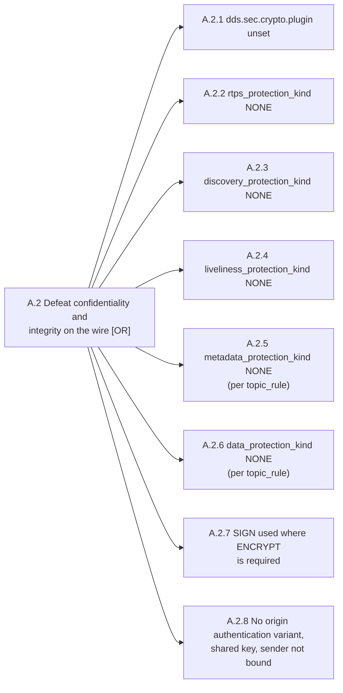

## A.2 Defeat confidentiality and integrity on the wire, `DDS:Crypto:AES-GCM-GMAC` (T1 to T2)

Protection kinds accepted by the `governance.p7s` document are `NONE`, `SIGN` and `ENCRYPT`, plus the origin-authentication variants in the DDS-Security specification. One path per parameter.



A.2.2 to A.2.8 are read out of the governance document, so extract it once:

```sh
openssl smime -verify -text -in $KEYSTORE/enclaves/governance.p7s -inform SMIME \
        -CAfile $KEYSTORE/public/permissions_ca.cert.pem > /tmp/governance.xml
```

`-text` strips the MIME header the document is signed with, so xmllint can parse the output. A non-zero exit here is A.3.16, and it makes every check below undecided rather than clean.

Commands below use `$KEYSTORE`, `$ENVFILE`, `$RUN` and the rest; [the README](../../README.md) sets them.

### A.2.1 Crypto plugin is AES-GCM-GMAC

`Cons E2 E3` · `T T1` · `P P1` · `X X3`

**Parameter.** `dds.sec.crypto.plugin`

**Misconfigured value.** Not `builtin.AES-GCM-GMAC`

**Path to effect.** Authentication and access control may still run, but every RTPS message crosses the network in the clear. A passive tap yields the full graph.

```sh
xmllint --xpath '//*[local-name()="property"]' $XMLPROFILE | grep -A1 crypto.plugin
```

Anything but `builtin.AES-GCM-GMAC`, or absent, is the finding: every RTPS message crosses the network in the clear.

**Cyclone DDS.** `<Cryptographic>` under `//CycloneDDS/Domain/Security`, with no `<Library>` or one naming `dds_security_crypto`:

```sh
xmllint --xpath '//*[local-name()="Security"]/*[local-name()="Cryptographic"]' $XMLPROFILE
```

No `<Cryptographic>` element is the finding.

**Example**, the lab in its `all-open` posture:

```
XPath set is empty
```

**Zenoh.** The link protocol of every endpoint:

```sh
zq $ZROUTER listen.endpoints
zq $ZSESSION transport.link.protocols
```

A `tcp/` or `udp/` endpoint is the finding. So is a `protocols` list that is absent or names anything besides `tls` or `quic`, because a peer can then connect in plaintext.

### A.2.2 RTPS protection

`Cons E2 E3` · `T T1` · `P P1` · `X X3`

**Parameter.** `<rtps_protection_kind>`, domain rule

**Misconfigured value.** `NONE`

**Path to effect.** Whole-message protection is off. The attacker sees and can splice complete RTPS datagrams, including submessages belonging to topics that do have data protection headers.

```sh
xmllint --xpath '//*[local-name()="rtps_protection_kind"]/text()' /tmp/governance.xml
```

Anything but `ENCRYPT` or `ENCRYPT_WITH_ORIGIN_AUTHENTICATION` is the finding. `SIGN` here is A.2.7, and it is what `create_keystore` emits while setting every other kind in the same template to `ENCRYPT`.

```sh
P0=$((7400 + 250 * DOMAIN))      # RTPS ports of the domain, 250 from 7400 + 250 x domain
tcpdump -i $IFACE -n -w /tmp/rtps.pcap "udp portrange $P0-$((P0 + 249))"
tshark -r /tmp/rtps.pcap -Y rtps -T fields -e rtps.sm.id
```

Plain `DATA` submessages are the finding. `SEC_PREFIX`, `SEC_BODY` and `SRTPS_PREFIX` are the protected forms. An empty capture proves nothing on its own — co-located nodes use shared memory, and the traffic never reaches `$IFACE`.

**Example**, the lab in its `dds.no-encryption` posture:

```
NONE
```

**Zenoh.** Zenoh has no per-message protection kinds. It encrypts the whole link or nothing, so A.2.2 to A.2.7 collapse into one question: is the link TLS. On the wire:

```sh
tshark -i $IFACE -f 'tcp port 7447' -Y 'tcp.len > 0 && !tls' -c 5 -T fields -e ip.src -e ip.dst -e tcp.len
```

Any output line is plaintext Zenoh, and key expressions, type names and payloads are readable in it. A TLS link shows only TLS 1.3 records.

### A.2.3 Discovery protection

`Cons E3 E4` · `T T1` · `P P1` · `X X3`

**Parameter.** `<discovery_protection_kind>`, domain rule

**Misconfigured value.** `NONE`

**Path to effect.** SPDP and SEDP in the clear, exposing node names, topic names, types, QoS and the IP and port of every endpoint. This is reconnaissance and it enables spoofed discovery announcements.

```sh
xmllint --xpath '//*[local-name()="discovery_protection_kind"]/text()' /tmp/governance.xml
```

`NONE` is the finding: SPDP and SEDP expose node names, topic names, types, QoS and every endpoint's address.

```sh
strings /tmp/rtps.pcap | grep -E 'rt/|geometry_msgs|sensor_msgs'
```

Readable ROS topic or type names on the wire is the finding, and it is the same one A.2.3 states from the document side. This is the version that goes in a report, because it is what the attacker actually read.

**Example**, the lab in its `dds.no-encryption` posture:

```
NONE
```

**Zenoh.** The graph is published as liveliness tokens under `@ros2_lv/<domain>/...`, and the admin space `@/**` exposes every peer's publishers, subscribers and link state. Any peer that connects can read both, and a passive tap can too when the link is plaintext (A.2.2).

```sh
zq $ZSESSION adminspace
zq $ZROUTER adminspace
```

`"read": true` is the finding on a robot that does not need remote introspection. It is the default and what `generate_configs` writes.

### A.2.4 Liveliness protection

`Cons E4` · `T T1` · `P P1` · `X X2`

**Parameter.** `<liveliness_protection_kind>`, domain rule

**Misconfigured value.** `NONE`

**Path to effect.** Liveliness assertions are unauthenticated, so an attacker forges "alive" for a dead node, leaving the robot trusting stale data, or forces liveliness-lost on a live one, which is E4 or an emergency stop.

```sh
xmllint --xpath '//*[local-name()="liveliness_protection_kind"]/text()' /tmp/governance.xml
```

`NONE` is the finding: liveliness assertions become forgeable in both directions, stale-but-alive and alive-but-stopped.

**Zenoh.** No equivalent. See A.2.2: link-level TLS covers this, or nothing does.

### A.2.5 Metadata protection on safety topics

`Cons E1 E2` · `T T1` · `P P1` · `X X2`

**Parameter.** `<metadata_protection_kind>`, topic rule

**Misconfigured value.** `NONE`

**Path to effect.** Submessage metadata, writer GUID and sequence numbers, is exposed and unprotected. This enables replay and targeted injection even when the payload is encrypted.

```sh
xmllint --xpath '//*[local-name()="topic_rule"]' /tmp/governance.xml |
    grep -B5 '<metadata_protection_kind>NONE'
```

Judge per topic, not globally. `NONE` on a topic carrying actuation or perception data is the finding; on `/rosout` it is not. Metadata exposure enables replay and targeted injection even where the payload is encrypted.

**Zenoh.** No equivalent. See A.2.2: link-level TLS covers this, or nothing does.

### A.2.6 Data protection on safety topics

`Cons E2 E3` · `T T1` · `P P1` · `X X3`

**Parameter.** `<data_protection_kind>`, topic rule

**Misconfigured value.** `NONE`

**Path to effect.** The payload of that topic is readable and modifiable. Reached by editing the generated governance document to trade protection for throughput on high-rate topics such as `/scan` and image streams, which puts `NONE` on exactly the safety-relevant data.

```sh
xmllint --xpath '//*[local-name()="topic_rule"]' /tmp/governance.xml |
    grep -B6 '<data_protection_kind>NONE'
```

Same per-topic judgement. This is the one traded away for throughput on high-rate topics, which puts `NONE` on exactly the safety-relevant data.

**Zenoh.** No equivalent. See A.2.2: link-level TLS covers this, or nothing does.

### A.2.7 ENCRYPT where confidentiality is required

`Cons E3` · `T T1` · `P P3` · `X X3`

**Parameter.** Any `*_protection_kind`

**Misconfigured value.** `SIGN` where confidentiality is a requirement

**Path to effect.** `create_keystore` emits `rtps_protection_kind` as `SIGN` while every other kind in the same template is `ENCRYPT`, so whole-message confidentiality is already off in the tooling's own output. The same mistake is then repeated by hand on `/tf`, `/map` and mission topics, giving a passive attacker full situational awareness.

```sh
grep -cE '>SIGN(_WITH_ORIGIN_AUTHENTICATION)?<' /tmp/governance.xml
```

Then read each in context. `SIGN` on anything needing confidentiality — `/tf`, `/map`, camera, mission topics — is the finding. Integrity without confidentiality still hands a passive attacker full situational awareness.

**Zenoh.** No equivalent. See A.2.2: link-level TLS covers this, or nothing does.

### A.2.8 Origin authentication on actuation topics

`Cons E1 E2` · `T T2` · `P P3` · `X X3`

**Parameter.** Protection kind

**Misconfigured value.** Plain `SIGN` or `ENCRYPT` instead of `SIGN_WITH_ORIGIN_AUTHENTICATION` or `ENCRYPT_WITH_ORIGIN_AUTHENTICATION`

**Path to effect.** Group-shared key, so any legitimate participant in the domain can forge messages attributed to another. A compromised low-privilege node, a logger or a camera driver, can impersonate the motion planner. Neither the governance template nor any `ros2 security` verb emits an origin-authentication variant, so plain `ENCRYPT` is what a deployment runs unless someone adds it.

```sh
grep -E '_WITH_ORIGIN_AUTHENTICATION' /tmp/governance.xml
```

No match on an actuation topic rule is the finding. Neither the governance template nor any `ros2 security` verb emits an origin-authentication variant, so plain `ENCRYPT` is the state of an untouched deployment: the domain key is group-shared, and any participant can forge messages attributed to another.

**Zenoh.** No origin authentication. A node's ACL decides what it accepts by key expression, not by sender, and the subjects `generate_configs` writes match any authenticated peer (A.3.13). Any valid certificate can publish on `cmd_vel`.

**Mitigations** 
- Use `ENCRYPT` on `rtps_protection_kind` as the baseline, and on discovery and liveliness. 
- Set per-topic `data_protection_kind` to `ENCRYPT` for anything sensor-bearing or command-bearing. 
- Use the origin-authentication variants on all actuation topics. 
- Benchmark before trading protection for throughput, and record the residual risk explicitly rather than silently setting `NONE`.
