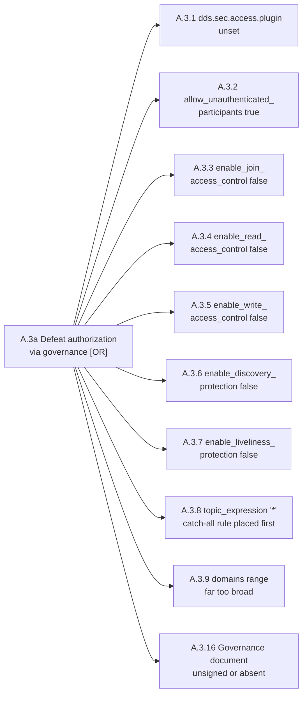
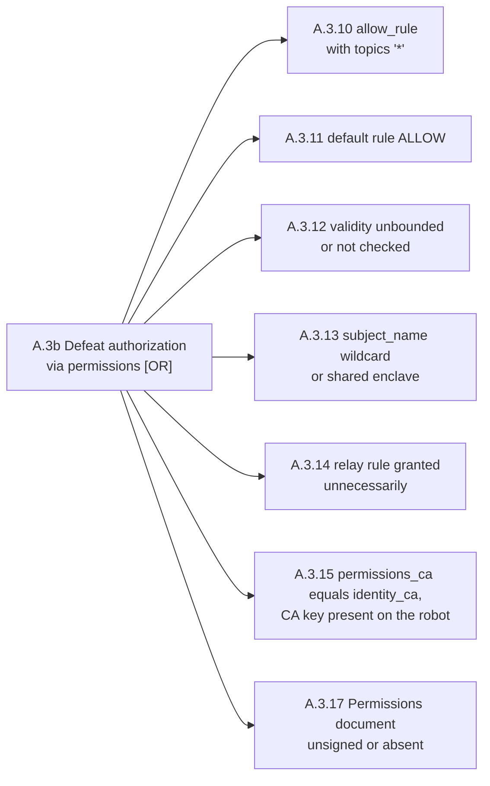

## A.3 Defeat authorization, `DDS:Access:Permissions` (T1 to T2)

The governance document (`governance.p7s`) and the per-enclave permissions (`permissions.p7s`) are both S/MIME-signed by the Permissions CA.

**A.3a Defeat authorization via the governance document (`governance.p7s`), leaves A.3.1 to A.3.9 and A.3.16**



**A.3b Defeat authorization via the permissions document (`permissions.p7s`), leaves A.3.10 to A.3.15 and A.3.17**



Extract both documents first — each exit status *is* the A.3.16 or A.3.17 check, and a failure makes every other check in that half undecided. `-text` strips the MIME header the documents are signed with, so xmllint can parse the output:

```sh
openssl smime -verify -text -in $KEYSTORE/enclaves/governance.p7s -inform SMIME \
        -CAfile $KEYSTORE/public/permissions_ca.cert.pem > /tmp/governance.xml

for p in $KEYSTORE/enclaves/*/permissions.p7s; do
    openssl smime -verify -text -in "$p" -inform SMIME \
            -CAfile $KEYSTORE/public/permissions_ca.cert.pem \
            > "/tmp/$(basename $(dirname $p)).xml"
done
```

Commands below use `$KEYSTORE`, `$ENVFILE`, `$RUN` and the rest; [the README](../../README.md) sets them.

### A.3.1 Access control plugin configured

`Cons E1 E2 E3` · `T T2` · `P P1` · `X X3`

**Parameter.** `dds.sec.access.plugin`

**Misconfigured value.** Not `builtin.Access-Permissions`

**Path to effect.** Authentication still gates who joins, but every authenticated participant may read and write everything. A compromised camera node can drive the robot.

```sh
xmllint --xpath '//*[local-name()="property"]' $XMLPROFILE | grep -A1 access.plugin
```

Anything but `builtin.Access-Permissions` is the finding: authentication still gates who joins, and every participant that joins may then read and write everything.

**Cyclone DDS.** `<AccessControl>` under `//CycloneDDS/Domain/Security`, holding `<Governance>`, `<Permissions>` and `<PermissionsCA>`, with no `<Library>` or one naming `dds_security_ac`:

```sh
xmllint --xpath '//*[local-name()="Security"]/*[local-name()="AccessControl"]' $XMLPROFILE
```

No `<AccessControl>` element is the finding.

**Zenoh.** `access_control.enabled`, in every node's config and in the router's:

```sh
for f in $KEYSTORE/enclaves/*/zenoh_session.json5; do echo "$f: $(zq "$f" access_control.enabled)"; done
zq $ZROUTER access_control.enabled
```

`true` on every node is required. `null` means the block is absent, which is the rmw_zenoh default. `false` on the router is what `generate_configs` writes: the router forwards everything and each node filters only its own traffic, so a node whose ACL is overridden (A.0.4) has no protection left.

### A.3.2 Unauthenticated participants refused

`Cons E1 E2 E3 E4` · `T T1` · `P P1` · `X X3`

**Parameter.** `<allow_unauthenticated_participants>`

**Misconfigured value.** `true`

**Path to effect.** The single most damaging governance switch. Unauthenticated participants join the domain, which effectively disables branch A.1 no matter how well PKI-DH is configured.

```sh
xmllint --xpath '//*[local-name()="allow_unauthenticated_participants"]/text()' /tmp/governance.xml
```

`true` is the finding, and it is the single most damaging switch in the document: it voids the whole of A.1 however well PKI-DH is configured.

**Example**, the lab in its `dds.unauthenticated-join` posture:

```
true
```

**Zenoh.** Only mTLS refuses an unauthenticated peer. A plaintext endpoint (A.2.1) or `enable_mtls` not `true` (A.1.1) is this finding.

### A.3.3 Join access control

`Cons E1 E2 E3` · `T T2` · `P P1` · `X X3`

**Parameter.** `<enable_join_access_control>`

**Misconfigured value.** `false`

**Path to effect.** Participant permissions are not evaluated at join time, so an authenticated participant with no valid grant still enters the domain.

```sh
xmllint --xpath '//*[local-name()="enable_join_access_control"]/text()' /tmp/governance.xml
```

`false` is the finding: permissions are not evaluated at join, so an authenticated participant with no valid grant still enters.

**Zenoh.** Joining is gated by mTLS alone. See A.1.1.

### A.3.4 Read access control on every topic rule

`Cons E3` · `T T2` · `P P1` · `X X3`

**Parameter.** `<enable_read_access_control>`, topic rule

**Misconfigured value.** `false`

**Path to effect.** Any participant may subscribe to that topic. Applied to a `*` topic rule to make debugging easier, it yields full E3.

```sh
xmllint --xpath '//*[local-name()="enable_read_access_control"]/text()' /tmp/governance.xml
```

Every topic rule must say `true`. One `false` on a `*` rule is full E3.

**Zenoh.** Read control is the subscriber's `declare_subscriber` rules and the publisher's egress rules. See A.3.5 for how to read them.

### A.3.5 Write access control on every topic rule

`Cons E1` · `T T2` · `P P1` · `X X3`

**Parameter.** `<enable_write_access_control>`, topic rule

**Misconfigured value.** `false`

**Path to effect.** Any participant may publish on that topic. On `/cmd_vel`, `/joint_trajectory_controller/joint_trajectory`, `/goal_pose` or an e-stop topic this is a direct safety event.

```sh
xmllint --xpath '//*[local-name()="enable_write_access_control"]/text()' /tmp/governance.xml
```

Every topic rule must say `true`. One `false` on `/cmd_vel`, `/goal_pose`, a trajectory topic or an e-stop topic is a direct safety event, not a configuration observation.

There is no safe live equivalent. An unauthenticated write can be proved by counting the subscriptions a writer matches and sending nothing, but no `ros2` verb creates a writer without publishing, and `ros2 topic pub` on an actuation topic is E1, uncommanded motion. Decide this leaf from the document unless the engagement is armed in writing and the machine is on blocks.

**Zenoh.** Write control is the publisher's egress `put` rules and the subscriber's ingress rules. List which enclaves mention the actuation topics:

```sh
grep -lE '"[0-9]+/(cmd_vel|goal_pose)/' $KEYSTORE/enclaves/*/zenoh_session.json5
```

The list holds publishers and subscribers alike: in the lab, `mission_planner`, the one legitimate publisher, and `motion_controller`, the subscriber, are expected. Any other enclave, or a publication rule in an enclave that should only listen, is the finding. A clean list is not enough on its own: with wildcard subjects (A.3.13) any certificate holds the grants of the node that does command motion.

### A.3.6 Discovery protection on every topic rule

`Cons E3` · `T T1` · `P P1` · `X X3`

**Parameter.** `<enable_discovery_protection>`, topic rule

**Misconfigured value.** `false`

**Path to effect.** That topic's endpoints are announced in unprotected discovery even when the domain protects discovery, giving a selective topology leak.

```sh
xmllint --xpath '//*[local-name()="enable_discovery_protection"]/text()' /tmp/governance.xml
```

`false` on a rule announces that topic's endpoints in unprotected discovery even where the domain protects discovery: a selective topology leak.

**Zenoh.** No per-topic equivalent. One rule on `@ros2_lv/<domain>/**` covers every liveliness token, so every node sees the whole graph. See A.2.3.

### A.3.7 Liveliness protection on every topic rule

`Cons E4` · `T T2` · `P P1` · `X X2`

**Parameter.** `<enable_liveliness_protection>`, topic rule

**Misconfigured value.** `false`

**Path to effect.** Liveliness for that topic is unprotected, so E4 can be targeted at one critical publisher.

```sh
xmllint --xpath '//*[local-name()="enable_liveliness_protection"]/text()' /tmp/governance.xml
```

`false` lets E4 be aimed at one critical publisher rather than at the domain.

**Zenoh.** No per-topic equivalent. See A.3.6.

### A.3.8 Rule ordering

`Cons E1 E2 E3` · `T T2` · `P P3` · `X X3`

**Parameter.** `<topic_expression>`

**Misconfigured value.** A `*` rule placed **first** in `<topic_access_rules>`

**Path to effect.** First-match semantics mean the permissive catch-all shadows every specific rule below it. The governance template ships exactly one `*` rule, so the error appears the moment specific rules are added below it instead of above it, and it silently disables the whole topic policy.

```sh
xmllint --xpath '//*[local-name()="topic_expression"]/text()' /tmp/governance.xml
```

Order is the whole check, so read the output *in document order* and find where `*` sits. A `*` rule before any specific rule shadows every one of them — first match wins — and silently disables the topic policy. The template ships exactly one `*` rule, so this appears the moment specific rules are added below it instead of above.

**Example**, the lab in its `dds.wildcard-permissions` posture:

```
*
rt/cmd_vel
rt/goal_pose
rt/scan
rt/odom
```

**Zenoh.** Not covered: Zenoh's ACL does not use the governance rule ordering this leaf is about. Over-broad key expressions are A.3.10.

### A.3.9 Domain scoping

`Cons E1 E2 E3` · `T T2` · `P P1` · `X X2`

**Parameter.** `<domains>`

**Misconfigured value.** A broad range such as `0-230` where the governance template scopes the rule to one domain, so the range is a deliberate hand-widening

**Path to effect.** The rule applies in domains it was never reviewed for, so a test or lab domain inherits production grants, or the reverse.

```sh
xmllint --xpath '//*[local-name()="domains"]' /tmp/governance.xml
```

A range such as `0-230` where `$DOMAIN` is one domain is the finding: the rule applies in domains nobody reviewed it for.

**Zenoh.** Every ACL key expression should start with the operational domain, or with `@ros2_lv/<domain>/` for liveliness:

```sh
zq $ZSESSION access_control.rules | grep -A4 key_exprs
```

A key expression that starts with `*` or `**` grants every domain on the router.

### A.3.10 No wildcard topics in a grant

`Cons E1 E2 E3` · `T T2` · `P P3` · `X X3`

**Parameter.** `<publish>` and `<subscribe>` topic lists

**Misconfigured value.** `*` inside an `allow_rule`

**Path to effect.** The enclave is omnipotent. Least privilege is gone, so compromise of any one node is compromise of the graph. The default policy template grants `/*` with `publish="ALLOW"` and `subscribe="ALLOW"`, so this is the starting state rather than a drift from it, and `ros2 security generate_policy` is what replaces it with an enumerated list.

```sh
grep -E '<(publish|subscribe)>' -A3 /tmp/*.xml | grep '\*'
```

A `*` in a publish or subscribe list inside an `allow_rule` is the finding: that enclave is omnipotent, so compromise of any one node is compromise of the graph. The default policy template grants `/*`, so this is the starting state that `ros2 security generate_policy` exists to replace.

The T2 version, read-only, with the credential the client agreed to hand over:

```sh
ROS_SECURITY_ENABLE=true ROS_SECURITY_STRATEGY=Enforce \
ROS_SECURITY_KEYSTORE=$KEYSTORE ROS_SECURITY_ENCLAVE_OVERRIDE=/scan_publisher \
ROS_DOMAIN_ID=$DOMAIN ros2 topic echo /cmd_vel
```

A sensor driver's credential reading an actuation topic is the finding. Run it in its own shell — those five variables must not leak into any T1 check afterwards.

**Zenoh.** Wildcards in the ACL key expressions. `generate_configs` legitimately writes `*` for the type and hash segments, as in `42/scan/*/*`, and `**` under `@adv/` and `@ros2_lv/`. A wildcard in the topic segment is the finding:

```sh
grep -nE '"[0-9]+/(\*\*|\*/)' $KEYSTORE/enclaves/*/zenoh_session.json5
```

Any match grants every topic of the domain.

### A.3.11 Grants default to DENY

`Cons E1 E2 E3` · `T T2` · `P P1` · `X X3`

**Parameter.** `<default>`

**Misconfigured value.** `ALLOW`, where the specification's implied default with no `<default>` element is `DENY`

**Path to effect.** Every topic not explicitly denied is permitted. It fails open, so new topics added later are automatically world-writable.

```sh
grep -c '<default>DENY</default>' /tmp/*.xml
```

Against the grant count. A grant whose `<default>` is `ALLOW`, or absent where the tooling wrote `ALLOW`, fails open: every topic added later is world-writable without anyone editing the policy.

**Zenoh.** `access_control.default_permission`:

```sh
for f in $KEYSTORE/enclaves/*/zenoh_session.json5; do echo "$f: $(zq "$f" access_control.default_permission)"; done
```

`"deny"` is clean, and it is what `generate_configs` writes. `"allow"` fails open.

### A.3.12 Grant validity bounded

`Cons E5` · `T T3` · `P P3` · `X X3`

**Parameter.** `<validity>`

**Misconfigured value.** `<not_after>` copied from the certificate by the permissions template, so the 3650 days of A.1.9, or expiry unenforceable because of an unauthenticated host clock

**Path to effect.** Grants never age out, so a decommissioned enclave stays authorised.

```sh
xmllint --xpath '//*[local-name()="validity"]' /tmp/<enclave>.xml
```

A `not_after` copied from the certificate, so the 3650 days of A.1.9, is the finding. In the lab `TARGET_PERMS_DAYS` sets it independently: 365 days in the baseline, 36500 in `all-open`. Read with B.2.5: validity evaluated against an unauthenticated clock is not a bound.

**Zenoh.** No equivalent: an ACL has no validity period and holds as long as the file does. Certificate lifetimes are A.1.9.

### A.3.13 Specific subject names, enclaves not shared

`Cons E1 E2 E3` · `T T2` · `P P3` · `X X3`

**Parameter.** `<subject_name>`

**Misconfigured value.** Wildcard or loose DN matching, or **one shared enclave** (`/`) for all nodes on the robot

**Path to effect.** Per-node segmentation collapses to a single identity, and the grant applies to whichever process holds the key. The default policy template defines one `/` enclave, so a deployment that never split it runs this.

```sh
xmllint --xpath '//*[local-name()="subject_name"]/text()' /tmp/*.xml
ls -d $KEYSTORE/enclaves/*/
```

A wildcard DN is the finding. So is a single enclave for the whole robot — one directory under `enclaves/`, the `/` the default template defines — because per-node segmentation then collapses to whichever process holds the key.

**Example**, the lab in its `shared-enclave` posture:

```
*
/target-keystore/enclaves/robot/
```

**Zenoh.** The ACL `subjects`:

```sh
zq $ZSESSION access_control.subjects
```

A subject whose `cert_common_names`, `usernames`, `interfaces`, `zids` and `link_protocols` are all `null` matches every peer. `generate_configs` writes exactly that, for the node's subject and for `router`, so any valid certificate holds every node's grants. Pin `cert_common_names` to the enclave's CN.

### A.3.14 No unnecessary relay grants

`Cons E2 E4` · `T T2` · `P P1` · `X X2`

**Parameter.** `<relay>`

**Misconfigured value.** Granted where not needed

**Path to effect.** The participant may relay traffic it neither publishes nor subscribes, giving it a bridge and replay position inside the domain.

```sh
grep -l '<relay>' /tmp/*.xml
```

A `<relay>` rule on an enclave that does not genuinely bridge domains is the finding: it hands that participant a relay and replay position inside the domain.

**Zenoh.** No grant to check: the router relays every key expression between peers, because its ACL is off (A.3.1).

### A.3.15 Permissions CA distinct, its key absent

`Cons E1 E2 E3 E5` · `T T3` · `P P3` · `X X3`

**Parameter.** `dds.sec.access.builtin.Access-Permissions.permissions_ca`

**Cyclone DDS.** `AccessControl/PermissionsCA`

**Misconfigured value.** The same CA as `identity_ca`, **and** the CA private key present on the robot, for example `keystore/private/ca.key.pem` shipped in the image

**Path to effect.** An attacker with host read access mints their own `permissions.p7s` with `topics: "*"` and a matching identity, producing a fully legitimate attacker participant that is indistinguishable from a real node. Terminal for the whole of branch A. `create_keystore` creates a single CA and uses it as both Identity and Permissions CA, and leaves its private key in `keystore/private/`, so this holds unless someone removed it.

```sh
openssl x509 -noout -fingerprint -sha256 -in $KEYSTORE/public/identity_ca.cert.pem
openssl x509 -noout -fingerprint -sha256 -in $KEYSTORE/public/permissions_ca.cert.pem
ls -l $KEYSTORE/private
```

Equal fingerprints means one CA doing both jobs. Equal fingerprints *and* a key in `private/` is terminal: the attacker mints a matching identity and permissions pair that no check distinguishes from a real node. `create_keystore` produces exactly this.

**Example**, the lab in its `all-open` posture:

```
sha256 Fingerprint=98:28:F8:4F:98:27:44:D6:F9:7E:51:BD:...
sha256 Fingerprint=98:28:F8:4F:98:27:44:D6:F9:7E:51:BD:...
-rw-r--r-- 1 root rostarget 241 ca.key.pem
lrwxrwxrwx 1 root rostarget  10 identity_ca.key.pem -> ca.key.pem
lrwxrwxrwx 1 root rostarget  10 permissions_ca.key.pem -> ca.key.pem
```

**Zenoh.** One CA does both jobs by construction: there is no permissions CA, only `root_ca_certificate`. The second half, its key absent from the robot, applies unchanged.

### A.3.16 Governance signed

`Cons E1 E2 E3 E4` · `T T1` · `P P1` · `X X3`

**Parameter.** `governance.p7s` itself

**Misconfigured value.** Unsigned, or absent from the keystore

**Path to effect.** Every switch inside the governance document rests on the S/MIME signature. Without it, no setting in A.3.1 to A.3.9 can be trusted, and in `Permissive` strategy an absent document means no security at all.

The first extraction, and its exit status. Non-zero is the finding. `no content type` means the file is plain XML with a `.p7s` extension, never signed at all. Under `Permissive`, an absent document means no security rather than no start.

**Example**, the lab in its `all-open` posture:

```
Error reading S/MIME message
...:SMIME_read_ASN1_ex:no content type:...
exit 2
```

**Zenoh.** Not applicable: Zenoh reads no signed document. The ACL sits unsigned in the session config, so its integrity rests on file custody (A.4.1) and on `ZENOH_SESSION_CONFIG_URI` naming it. An unset URI falls back to the defaults, with no ACL.

### A.3.17 Permissions signed

`Cons E1 E2 E3` · `T T1` · `P P1` · `X X3`

**Parameter.** `permissions.p7s` itself

**Misconfigured value.** Unsigned, or absent from the keystore

**Path to effect.** Same argument as A.3.16, applied to the per-enclave grant. An unsigned permissions document can be edited freely by anyone who can write the file.

The second extraction, and each exit status. Non-zero on any enclave is the finding. An unsigned permissions document can be edited by anyone who can write the file, which makes A.3.10 to A.3.14 unenforceable for that enclave.

**Zenoh.** Not applicable, as for A.3.16.

**Mitigations** 
- Keep the Identity CA and the Permissions CA separate. 
- Never ship `keystore/private/` to a robot, since the CA key is needed to configure and not to run. 
- Order `topic_access_rules` specific-first with a restrictive `*` fallback, and set an explicit `<default>DENY</default>`. 
- Use one enclave per node with an enumerated topic list generated from the node's actual graph, via `ros2 security generate_policy`. 
- Bound `<validity>`, and scope `<domains>` to the single production domain ID.
- Review governance and permissions as code in CI, with a linter that rejects `*` in an `allow_rule` and any `NONE` protection kind, and that verifies both documents are signed.
