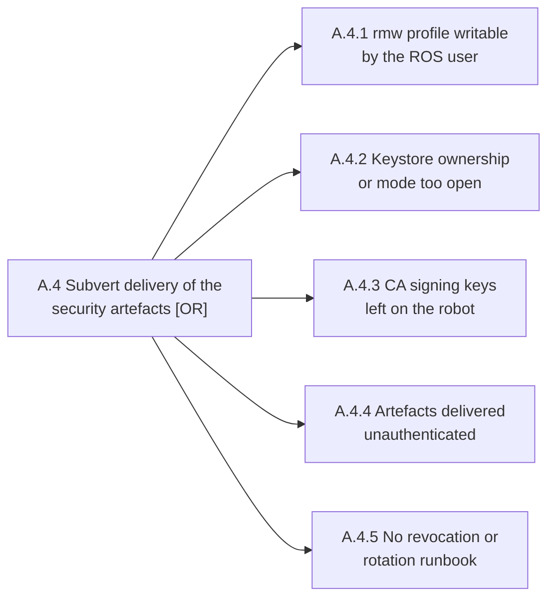

## A.4 Subvert delivery of the security artefacts (T1 to T3)

A.4 is about the artefacts on the robot, so these run through `$RUN` rather than against your copy.



Commands below use `$KEYSTORE`, `$ENVFILE`, `$RUN` and the rest; [the README](../../README.md) sets them.

### A.4.1 rmw profile not writable

`Cons E1 E2 E3 E5` · `T T3` · `P P2` · `X X3`

**Weakness.** Fast DDS XML profile (`FASTRTPS_DEFAULT_PROFILES_FILE`) writable by the ROS user

**Cyclone DDS.** The config file `CYCLONEDDS_URI` names, `file://` or a bare path, possibly several separated by commas. `CYCLONEDDS_URI` may also hold the XML inline, and then the unit or env file that sets it is the artefact to check

**Path to effect.** Attacker rewrites `PropertyPolicyQoS` to repoint `identity_ca` or `permissions_ca` at their own CA, or drops the plugin properties entirely, which is A.0.5. Survives reboot.

```sh
$RUN stat -Lc '%a %U %G %n' /keystore/fastdds_profile.xml
$RUN namei -l /keystore/fastdds_profile.xml
```

For Cyclone DDS, run the same two commands on the file `CYCLONEDDS_URI` names, for example `/keystore/cyclonedds.xml`.

Writable by `$ROSUSER`, by group or by world is the finding. This file names the CAs, so whoever writes it chooses the PKI the robot trusts, and the change survives reboot.

On Zenoh, the configs the two `ZENOH_*_CONFIG_URI` variables name, and every per-node copy:

```sh
$RUN sh -c "stat -Lc '%a %U %G %n' /keystore/zenohd.json5 /keystore/zenoh_session.json5 /keystore/enclaves/*/zenoh_session.json5"
```

The same finding applies, and the stake is higher: whoever writes a Zenoh config can turn its ACL off, not only repoint its CA.

### A.4.2 Keystore ownership and mode

`Cons E1 E2 E3 E5` · `T T3` · `P P3` · `X X3`

**Weakness.** Keystore directory `0777`, or owned by the account that ran `create_keystore`, which on a robot is the ROS user

**Path to effect.** Direct read of `key.pem`, or substitution of `governance.p7s` and `permissions.p7s` if the CA is also reachable.

```sh
$RUN stat -Lc '%a %U %G' /keystore
$RUN ls -ln /keystore/enclaves
```

`0777`, or owned by `$ROSUSER` rather than root, is the finding. Ownership by the account that ran `create_keystore` is the default outcome, not a drift from it.

**Example**, the lab in its `all-open` posture:

```
777 root ros
```

### A.4.3 CA signing keys absent

`Cons E1 E2 E3 E5` · `T T3` · `P P3` · `X X3`

**Weakness.** `keystore/private/ca.key.pem` present on the running robot

**Path to effect.** See A.3.15. The attacker becomes the CA. `create_keystore` leaves the CA signing keys in the keystore, so shipping the keystore to the robot ships the CA with it.

```sh
$RUN ls -l /keystore/private
```

Any file there is the finding, and it is terminal for the whole of branch A: with the CA key an attacker mints their own identity and their own `permissions.p7s`. `create_keystore` leaves it, so shipping the keystore ships the CA.

**Example**, the lab in its `all-open` posture:

```
-rw-r--r-- 1 root ros 241 ca.key.pem
lrwxrwxrwx 1 root ros  10 identity_ca.key.pem -> ca.key.pem
lrwxrwxrwx 1 root ros  10 permissions_ca.key.pem -> ca.key.pem
```

### A.4.4 Authenticated artefact delivery

`Cons E1 E2 E3 E5` · `T T1` · `P P2` · `X X1`

**Weakness.** Enclaves distributed by unauthenticated means: rsync over plain FTP, a USB stick, a shared NFS export, an unsigned OTA channel

**Path to effect.** A machine-in-the-middle swaps the enclave during provisioning, so the robot trusts the attacker's PKI from first boot.

No command. A process control: ask how enclaves reached the robot and what authenticated them in transit — signed OTA, or rsync over plain FTP, a USB stick, a shared NFS export. Nothing on the robot records which it was.

### A.4.5 Revocation and rotation runbook

`Cons E5` · `T T3` · `P P3` · `X X1`

**Weakness.** No revocation or rotation runbook

**Path to effect.** Any of the above becomes permanent once it happens.

No command. A process control: ask for the runbook, when it was last rehearsed, and who holds the CA. Its absence is what makes every other finding in A.4 permanent.

**Zenoh.** Rotation is the only revocation path, because Zenoh's TLS has no CRL (A.1.6). The runbook has to cover reissuing the certificates and redeploying every config that names them, the router's included.

**Mitigations** 
- Root-own the XML profile and the keystore directory, read-only to the ROS user. 
- Never place `keystore/private/` on a robot. 
- Distribute enclaves over an authenticated, signed channel with rollback. 
- Write and rehearse a revocation and rotation runbook, and record who holds the CA.
