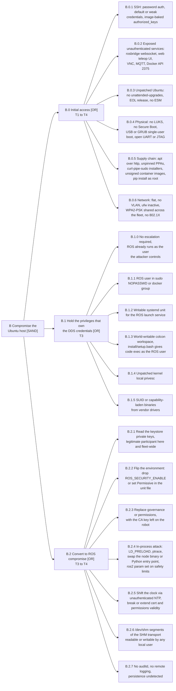

## 3. Branch B, unsecured Ubuntu host

> **On the gate.** B is a sequential AND, so all three conjuncts must hold, and in the order drawn. B.0 and B.1 reach no consequence on their own, so their `Cons` value is `(enabler)`, with one exception: B.0.2, an unauthenticated rosbridge, is a direct ROS read and write path and reaches E1 to E3 by itself.

| Part | Group | Leaves | T |
|---|---|---|---|
| [B.0](03-branch-b/b0-initial-access.md) | Initial access | B.0.1 to B.0.6 | T1 to T4 |
| [B.1](03-branch-b/b1-privileges.md) | Holding the privileges that own the DDS credentials | B.1.0 to B.1.5 | T3 |
| [B.2](03-branch-b/b2-ros-compromise.md) | Converting host access into ROS compromise | B.2.1 to B.2.7 | T3 to T4 |

Branch B commands run through `$RUN`, the transport that reaches the host: `ssh user@robot` on an engagement, `ssh -F /target-access/ssh_config davros-target sudo -n` in the lab.

## Sources

- [OpenSSH `sshd_config`](https://man.openbsd.org/sshd_config)
- [Ubuntu Server, OpenSSH server](https://ubuntu.com/server/docs/how-to/security/openssh-server/)
- [Ubuntu Server, automatic updates](https://documentation.ubuntu.com/server/how-to/software/automatic-updates/)
- [cloud-init, users and groups module](https://cloudinit.readthedocs.io/en/latest/reference/modules.html#users-and-groups)
- [`systemd.exec`](https://www.freedesktop.org/software/systemd/man/latest/systemd.exec.html)
- [`systemd-timesyncd.service`](https://www.freedesktop.org/software/systemd/man/latest/systemd-timesyncd.service.html)
- [RFC 8915, Network Time Security](https://www.rfc-editor.org/rfc/rfc8915.html)
- [Linux kernel, Yama LSM `ptrace_scope`](https://www.kernel.org/doc/html/latest/admin-guide/LSM/Yama.html)
- [Fast DDS v2.14.6, Shared memory transport](https://fast-dds.docs.eprosima.com/en/v2.14.6/fastdds/transport/shared_memory/shared_memory.html)
- [Cyclone DDS, Shared memory exchange](https://cyclonedds.io/docs/cyclonedds/latest/shared_memory/shared_memory.html)
- [rosbridge_suite](https://github.com/RobotWebTools/rosbridge_suite)
- [ROS 2 Jazzy, Security deployment guidelines](https://docs.ros.org/en/jazzy/Tutorials/Advanced/Security/Deployment-Guidelines.html)
- Kordy, B., Mauw, S., Radomirovic, S. and Schweitzer, P. ["Foundations of Attack-Defense Trees"](https://doi.org/10.1007/978-3-642-19751-2_6), FAST 2010
