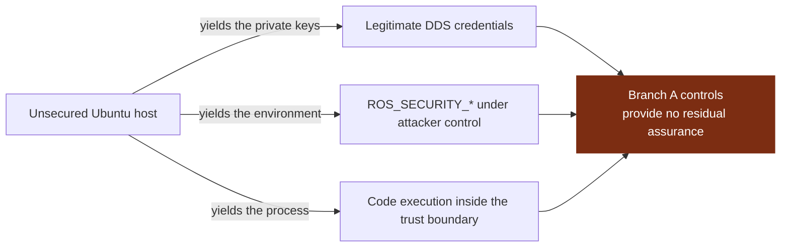

## 4. The critical observation

The two branches are not peers.

DDS-Security defends the **network** between participants. It assumes each host is trustworthy. Therefore:

1. **Host hardening is a prerequisite for DDS-Security to mean anything**, not a complement to it. Assess branch B first.
2. **The two highest-leverage single findings** in a typical ROS 2 deployment are `ROS_SECURITY_STRATEGY` left at Permissive (A.0.2, which fails open silently) and the Permissions CA private key present on the robot (A.3.15 and A.4.3, where the attacker becomes the issuer).
3. **Per-node enclaves with enumerated topics**, against A.3.10 and A.3.13, plus **origin authentication on actuation topics**, A.2.8, are what stop one compromised node from becoming a compromised robot. Without them, branch B only needs to succeed against the weakest node on the box.
4. **Physical access to one robot compromises the fleet** whenever identity material is shared (A.1.3) or the disk is unencrypted (B.0.4).
5. **A branch A result is not a robot assessment.** Branch B is only answerable with host access, so an assessment without host access decides at most the 46 branch A leaves and leaves the 19 branch B leaves open, and those 19 are the ones this section argues dominate.

---

## Sources

- [OMG DDS-Security v1.1](https://www.omg.org/spec/DDS-SECURITY/1.1/PDF)
- [ROS 2 design, DDS-Security integration](https://design.ros2.org/articles/ros2_dds_security.html)
- [ROS 2 Jazzy, Security deployment guidelines](https://docs.ros.org/en/jazzy/Tutorials/Advanced/Security/Deployment-Guidelines.html)
