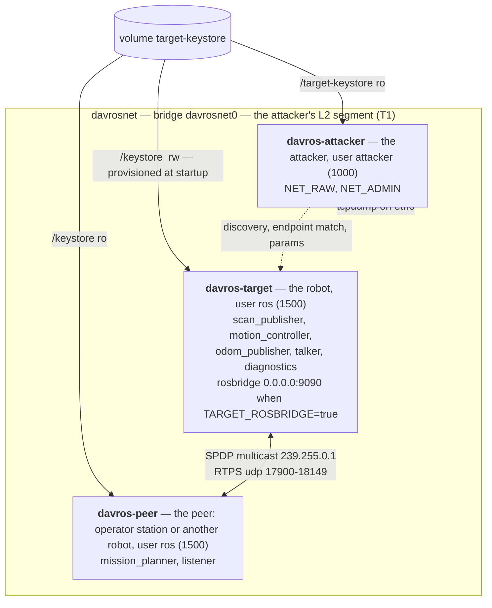

## 7. DaVROS topology

DaVROS is three containers on one bridge and one keystore volume.

**davros-attacker** is the attacker. It starts with no credential: `ROS_SECURITY_ENABLE`, `ROS_SECURITY_STRATEGY`, `ROS_SECURITY_KEYSTORE` and `ROS_SECURITY_ENCLAVE_OVERRIDE` are unset in every shell, because a T1 attacker that accidentally authenticates sees the opposite of the truth. The read-only keystore mount is the T3 view: what the ROS account can read on the robot, every enclave key included. The repository is mounted at `/workspace`. There is no docker socket: host-side commands (`$RUN` in the leaves) and posture changes run from the host.

**davros-target** provisions the keystore as root in `entrypoint.sh`, then drops to `ros` and spawns the robot-side nodes, one process and one enclave each.

**davros-peer** is the same image with `peer.sh` as its entrypoint. It stands for whatever the robot talks to off-box: an operator station, or another robot in the fleet. It runs the two nodes marked `host="peer"` in [graph_spec.py](../simulated_target/robot/graph_spec.py), so the robot has a real peer and the link between them is worth capturing. `/mission_planner` lives here, and it is the enclave rosbridge borrows.

By default everything is `ROS_DOMAIN_ID` 42 over `rmw_fastrtps_cpp`. A preset can move the target and the peer to another domain: `all-open` and `never-configured` use 0, the never-configured default. `davros-attacker` does not follow, because it takes `TARGET_DOMAIN_ID` from the host shell, not from `preset.env`, so finding the domain is part of A.0.6. The RTPS default port mapping, which Fast DDS and Cyclone DDS share, gives domain N the 250 ports from `7400 + 250*N`: domain 42 is **17900-18149** and domain 0 is **7400-7649**. Derive a capture filter from the domain rather than fixing it.
